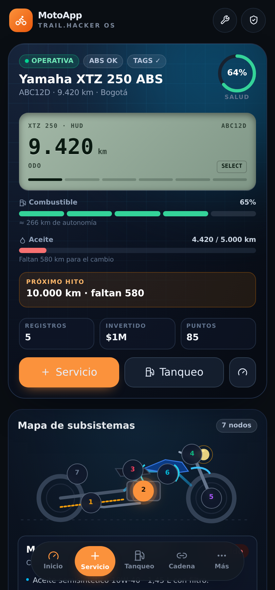
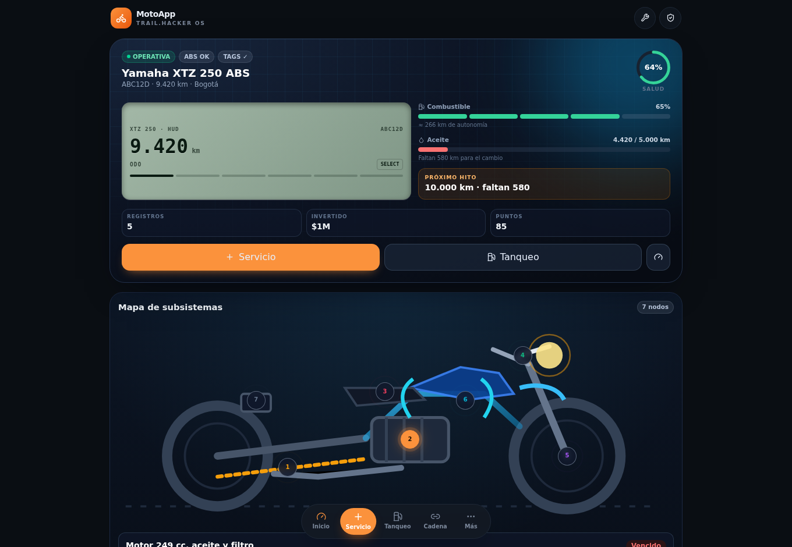
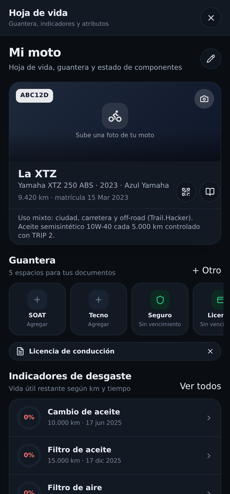
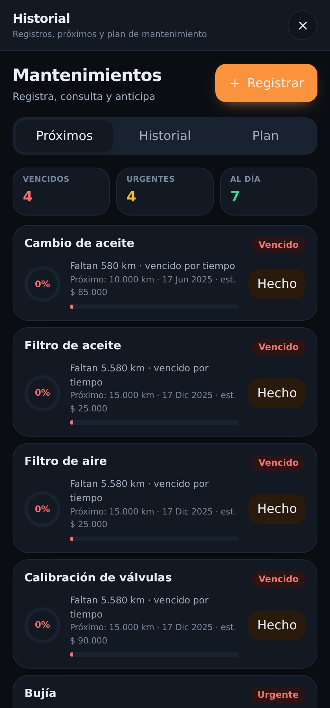
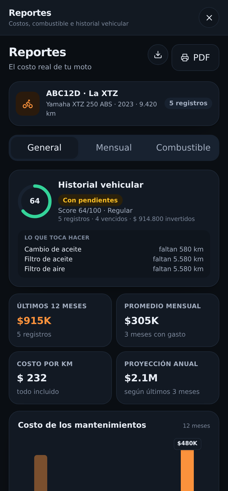
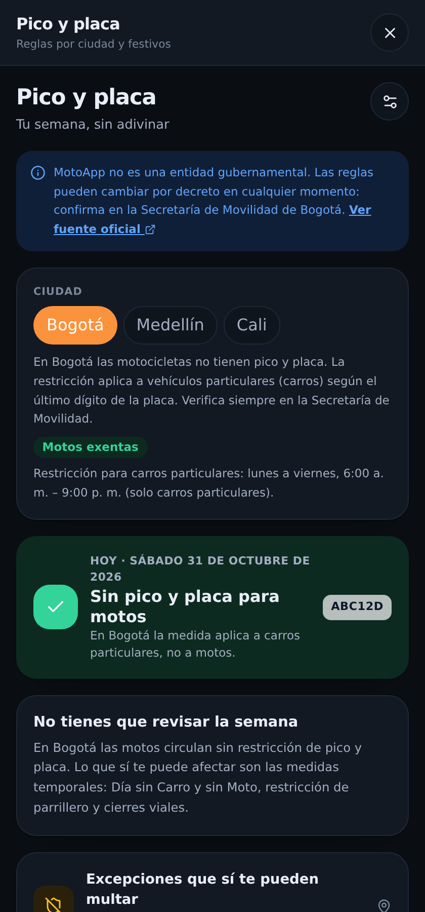

# MotoApp · Trail.Hacker OS

[](https://github.com/Macorreag/motoapp/actions/workflows/ci.yml)
[](https://github.com/Macorreag/motoapp/actions/workflows/deploy.yml)
[](https://github.com/Macorreag/motoapp/releases)
[](https://macorreag.github.io/motoapp/)
[](LICENSE)
[](docs/PRIVACY.md)


Hoja de vida, mantenimiento preventivo, alertas legales y bitácora de gastos para
**una** Yamaha XTZ 250. Es una app web estática: **sin backend, sin cuentas y sin
analytics**. Todo lo que registras se queda en tu navegador.

> **Demo:** <https://macorreag.github.io/motoapp/?demo=1> · con datos ficticios
> (placa `ABC12D`). La app arranca vacía y te guía con un onboarding de dos pasos.

| Dashboard (móvil) | Dashboard (escritorio) |
|---|---|
|  |  |

---

## Qué es

Una reimplementación del modelo de producto de las apps de mantenimiento de motos
(hoja de vida, mantenimientos por componente, guantera de documentos, alertas,
pico y placa, reportes), pensada para **una moto concreta** y no para flotas.

Todo vive en **un solo dashboard** tipo *Trail.Hacker OS*:

- **HUD de telemetría**: ODO, TRIP 1 (gasolina), TRIP 2 (aceite), rendimiento,
  autonomía y reloj, con el botón `SELECT` que cicla los datos como el tablero real.
- **Mapa de subsistemas** con 7 hotspots sobre un esquema SVG de la moto (arrastre,
  motor, eléctrico, tablero, ruedas, chasis, seguridad): especificaciones, alertas,
  herramientas y llaves de cada uno.
- **Checklist de los 10.000 km** con los 14 puntos del manual y progreso.
- **Asistente de cadena de 14 pasos** con cronómetros de 3 y 25 minutos.
- **Kit / EDC**, pendientes con prioridad, costos, estado legal y **consola de comandos**
  (`km 9500`, `nodo 3`, `cadena`, `checklist`, `servicio`, `tanqueo`, `ayuda`).

Las pantallas de detalle (hoja de vida, historial, plan, gastos, reportes, alertas,
pico y placa, talleres, ajustes) se abren como hojas a pantalla completa desde el
menú «Más».

| Hoja de vida | Mantenimientos | Reportes | Pico y placa |
|---|---|---|---|
|  |  |  |  |

---

## Funciones

| Módulo | Qué hace |
|---|---|
| **Hoja de vida** | Guantera con 5 espacios (SOAT, tecnomecánica, seguro, licencia, impuesto), indicadores de desgaste, atributos del vehículo y QR con los datos básicos |
| **Mantenimientos** | Registro con categoría, km, costo, taller y foto; historial por año/mes/categoría; plan editable por modelo con intervalos y costos |
| **Alertas** | SOAT, tecnomecánica, impuesto y alertas propias, con ventana de anticipación y **días proyectados** según tu ritmo real de km/día |
| **Gastos y tanqueos** | Combustible, rendimiento (km/L y km/gal), costo por km y desglose por categoría |
| **Reportes** | Barras, dona y score 0–100 (55 % desgaste real + 45 % estado legal), exportación CSV e impresión/PDF |
| **Pico y placa** | Reglas por ciudad (Bogotá exenta para motos, Medellín con rotación editable), festivos 2026 y excepciones (Día sin Carro, parrillero) |
| **Talleres** | Red de confianza con teléfono, dirección y calificación; órdenes de servicio abiertas y cerradas |
| **Zona Moto** | Puntos e insignias por mantener la moto al día |
| **Ajustes** | Tema claro/oscuro/auto, datos del perfil, respaldo/restauración JSON, datos de ejemplo y borrado total |

### Lo que la app **no** hace (a propósito)

- No consulta RUNT ni SIMIT: no tienen API pública y usan captcha. Se enlaza a los
  portales oficiales y tú registras los datos.
- No tiene cuentas, nube propia, publicidad ni paywall.
- No es multi-vehículo ni multi-usuario: es para **una** moto.

---

## Cómo correrla

Requisitos: **Node.js 20+** (ver [`.nvmrc`](.nvmrc)).

```bash
git clone https://github.com/Macorreag/motoapp.git
cd motoapp
npm install
npm run dev          # http://127.0.0.1:5180
```

- Para verla llena sin configurar nada: <http://127.0.0.1:5180/?demo=1>
- Build de producción: `npm run build` → `dist/` (estático, publicable en cualquier hosting).
- Preview del build: `npm run preview` → <http://127.0.0.1:5181>

| Script | Qué hace |
|---|---|
| `npm run dev` | Servidor de desarrollo en `127.0.0.1:5180` |
| `npm run build` | Typecheck + build estático en `dist/` |
| `npm run preview` | Sirve `dist/` en `127.0.0.1:5181` |
| `npm run typecheck` | `tsc --noEmit` |
| `npm run build:gas` | Genera el bundle para Google Apps Script (`gas/`) |

### Variables de entorno

Solo para los enlaces «Abrir la hoja» / «Abrir Apps Script» de la versión con Google
Sheets. Son **opcionales** y no se versionan:

```bash
cp .env.example .env.local
# VITE_HOJA_ID=...
# VITE_SCRIPT_ID=...
```

Si no existen, la app funciona igual y simplemente oculta esos botones.

---

## Arquitectura

- **React 19 + TypeScript + Vite 6 + Tailwind CSS 4**, sin librería de componentes.
- **Gráficas propias en SVG** (barras, dona, línea, anillos): cero dependencias de charts.
- **Persistencia intercambiable**: `src/store/backend.ts` define `BackendLocal`
  (IndexedDB con respaldo en `localStorage`) y `BackendGas` (`google.script.run`).
  El resto de la app no sabe dónde viven los datos.
- **Mutaciones puras** (`src/store/mutaciones.ts`): la misma función actualiza el
  estado local y sirve para reaplicar un cambio cuando la hoja cambió mientras editabas.
- **Router por hash** (`#/inicio`, `#/vehiculo`, …) para publicar como sitio estático
  sin configuración de servidor.
- **QR** generado en el cliente con `qrcode`.

```
src/
  App.tsx                 rutas, hojas y modales globales
  types.ts                modelo de datos (Vehículo, Componente, Mantenimiento…)
  data/
    catalogo.ts           categorías, guantera y PLAN_XTZ250 (intervalos y costos)
    ficha.ts              ficha técnica verificada de la XTZ 250
    trail.ts              datos de demo, subsistemas, checklist, cadena, EDC
    seed.ts               estado inicial, onboarding y datos de ejemplo
  lib/
    calc.ts               vida útil, salud, avisos, gastos, combustible, ritmo km/día
    legal.ts              SOAT, RTM, impuesto, comparendos, trámites
    picoPlaca.ts          reglas por ciudad + festivos 2026
    format.ts             fechas, moneda COP, textos
    archivos.ts           compresión de fotos y descargas
    router.ts             hash router
  store/
    AppStore.tsx          estado + acciones + puntos
    backend.ts            IndexedDB y google.script.run detrás de la misma interfaz
    mutaciones.ts         cambios puros y reaplicables
  components/             UI, charts, iconos, formularios
  screens/                Dashboard + hojas de detalle + onboarding
docs/
  research/               informes con fuentes (producto, XTZ 250, normativa)
  capturas/               capturas de la app (generadas con tools/capturas.py)
  gas.md                  versión Google Sheets paso a paso
  PRIVACY.md              qué datos hay y dónde viven
tools/
  capturas.py / smoke.py  capturas y prueba E2E con Playwright
  gas-mock-test.py        cliente con google.script.run simulado
  gas-sheet-test.mjs      capa de datos con SpreadsheetApp simulado
```

### Cómo calcula la app

```
kmHechos  = kmActual − ultimoKm
pctKm     = 1 − kmHechos / intervaloKm
pctTiempo = 1 − díasDesde(ultimaFecha) / (intervaloMeses × 30,44)
restante  = min(pctKm, pctTiempo)      ← se dispara lo que ocurra primero
```

Estados: `vencido ≤ 2 % · urgente ≤ 15 % · próximo ≤ 35 % · al día`.

- **Salud del vehículo** = 55 % promedio de vida útil + 45 % cumplimiento legal, con techo de 100.
- **Días proyectados** = `kmRestantes / ritmoKmDiario`, con el ritmo calculado entre el
  primer y el último registro (km/día reales, no una constante).

---

## Datos y privacidad

- **No hay servidor**: la app es un build estático. Los datos viven en IndexedDB.
- **El repositorio no contiene datos personales ni credenciales.** La demo usa placa
  ficticia, taller genérico y números de póliza de ejemplo.
- **Los IDs de Google no se versionan**: `.env.local`, `gas/.clasp.json`,
  `gas/Bundle.gs` y `gas/app.html` están en `.gitignore`; el CI falla si aparecen
  o si detecta patrones de secretos.
- Respaldo JSON bajo tu control; botón **Borrar todo** para eliminar el almacenamiento.
- La versión de Google Sheets se despliega con `access: MYSELF` (solo tu cuenta).

Detalle completo en [`docs/PRIVACY.md`](docs/PRIVACY.md).

---

## Versión Google Sheets (opcional)

El mismo código de interfaz puede guardar en **tu** hoja de cálculo con Google Apps
Script: sincronización cada 15 s, control de conflictos por token y edición desde la
hoja o desde la app. La guía completa (pestañas, despliegue y problemas frecuentes)
está en [`docs/gas.md`](docs/gas.md).

La versión del navegador es la que se publica en GitHub Pages y **no necesita nada
de esto**.

---

## Investigación documentada

Los datos de mantenimiento y las reglas legales no salen de la nada: están
investigados con fuentes primarias y numeradas.

| Documento | Contenido |
|---|---|
| [`00-resumen.md`](docs/research/00-resumen.md) | Resumen ejecutivo de los tres informes |
| [`01-tucamo-producto.md`](docs/research/01-tucamo-producto.md) | Módulos, modelo de datos, UX y dolores de usuarios del producto de referencia |
| [`02-xtz250-mantenimiento.md`](docs/research/02-xtz250-mantenimiento.md) | Ficha técnica, tabla oficial de mantenimiento, vida útil, fallas conocidas y costos |
| [`03-normativa-colombia.md`](docs/research/03-normativa-colombia.md) | SOAT, RTM, impuesto, pico y placa, trámites y comparendos |
| [`xtz250-seed.json`](docs/research/xtz250-seed.json) | 24 componentes con rangos de vida útil y costos (min/típico/máx) |

Hallazgos que corrigen mitos de taller (todo con fuente en el informe):

| Ítem | Mito frecuente | Manual Yamaha / dato verificado |
|---|---|---|
| Aceite de motor | cada 3.000 km | **5.000 km o 6 meses** (el «3.000» eran **millas**) |
| Filtro de aceite | en cada cambio de aceite | **10.000 km** |
| Bujía | cambiar en cada servicio | revisar siempre, **cambiar a 10.000 km** (NGK DR8EA, gap 0,6–0,7 mm) |
| Cadena | «cuando suene» | **revisar y lubricar cada 500 km**, holgura 30–40 mm |
| Líquido de frenos | por km | **cada 2 años** (DOT 4) |
| Presión de llantas | 28–30 psi «de taller» | **18/22 psi solo · 22/29 psi con pasajero**, en frío |
| Relación | 15/46 «Lander» | **13/40** (la XTZ colombiana no usa el kit brasileño) |

---

## Pruebas

```bash
npm run typecheck                       # TypeScript estricto
npm run build                           # build de producción

python3 tools/smoke.py                  # E2E: onboarding → servicio → historial → tanqueo → persistencia
python3 tools/capturas.py               # regenera docs/capturas/ con datos de demo
python3 tools/gas-mock-test.py          # cliente GAS con google.script.run simulado
node tools/gas-sheet-test.mjs           # Hoja.gs con SpreadsheetApp simulado
```

El CI ejecuta typecheck, build y un escaneo de secretos/IDs en cada push y PR.

---

## Despliegue

### GitHub Pages (automático)

Cada push a `main` compila con Vite y publica `dist/` mediante
[`.github/workflows/deploy.yml`](.github/workflows/deploy.yml).

- Sitio: <https://macorreag.github.io/motoapp/>
- Para activarlo en un fork: *Settings → Pages → Source: GitHub Actions*.

### Cualquier hosting estático

`npm run build` genera `dist/` con rutas relativas: sirve igual en Netlify,
Cloudflare Pages, un bucket S3 o un `python -m http.server`.

### Google Apps Script

Ver [`docs/gas.md`](docs/gas.md).

---

## Roadmap

- Notificaciones locales para recordatorios de mantenimiento.
- Lectura del odómetro por foto (OCR).
- Presupuesto mensual por categoría.
- Exportar la hoja de vida en un PDF de una página.
- Sincronización opcional entre dispositivos.

---

## Créditos y descargo

Inspirado en el producto y la UX de **Tucamo** (<https://tucamo.co>) — **sin
afiliación**. La marca, el nombre y sus capturas pertenecen a Tucamo SAS; las
capturas de referencia usadas durante el análisis **no** se redistribuyen en este
repositorio.

Los intervalos, costos y reglas son de referencia y **no sustituyen el manual del
fabricante ni la información oficial** del RUNT, el SIMIT o tu secretaría de
movilidad. Verifica siempre antes de viajar o de tomar una decisión de mantenimiento.

## Licencia

[MIT](LICENSE) © 2026 Macorreag.

¿Quieres aportar? Lee [`CONTRIBUTING.md`](CONTRIBUTING.md) y el
[`CODE_OF_CONDUCT.md`](CODE_OF_CONDUCT.md). Para vulnerabilidades o filtración de
datos, usa [`SECURITY.md`](SECURITY.md). Los cambios están en
[`CHANGELOG.md`](CHANGELOG.md).
