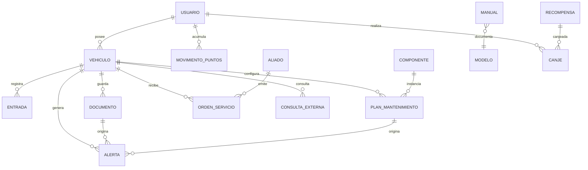

# Tucamo (tucamo.co) — Investigación de producto para clonar como app web

**Fecha del relevamiento:** 28–29 de octubre de 2026
**Objeto:** app de gestión preventiva de vehículos (motos y carros), Bogotá, Colombia.
**Uso previsto:** insumo de implementación para un clon web (uso personal, una moto).
**Convención:** cada afirmación lleva la fuente entre corchetes (`[S3]`) o va marcada como **(inferido)** cuando es una deducción mía a partir de capturas/comportamiento y no está publicada. La lista de fuentes está al final.

---

## 0. Ficha del producto y hechos verificables

| Dato | Valor | Fuente |
|---|---|---|
| Marca / dominio | Tucamo · tucamo.co | [S1] |
| Empresa | Tucamo SAS, Bogotá, Colombia · fundada en 2023 · 1 empleado (self-owned) | [S1][S18] |
| Fundador / desarrollador en tiendas | Harrinson Gutierrez Coronado (contacto en la ficha pública de la tienda) | [S4][S5] |
| Apps | Android `com.tucamo.app` · iOS `id6476043087` (iOS 15+, ~103 MB, v1.0.80) | [S4][S5] |
| Lanzamiento iOS | 17-ene-2024 | [S5] |
| Rating | 4,8★ Google Play (149 opiniones) · 4,6★ App Store (47 valoraciones, 4,8★ muestra la web) | [S4][S5][S1] |
| Descargas Android | 5 K+ | [S4] |
| Categoría Play | «Autos y vehículos» | [S4] |
| Categoría App Store | Productividad / Utilidades | [S5] |
| Métricas de marketing | «6.000+ vehículos gestionados», «12+ talleres aliados», «4,8★ App Store» | [S1][S10] |
| Precio base | Gratis; Premium 1,99 USD/mes · 7,99 USD/semestre · 13,99 USD/año; 7 días de prueba | [S3][S4] |
| Límite de vehículos | 1 vehículo gratis · hasta 3 con Premium | [S1][S3] |
| Idiomas / monedas | Español y portugués · 7 monedas · tema claro/oscuro · «adaptada a tu país» (multipaís) | [S3][S5] |

**Contradicciones detectadas (importantes para no copiar errores):**

1. **Precio anual:** 13,99 USD en web y Play [S3][S4], pero la descripción de App Store todavía dice «Anual: $11.99» [S5].
2. **Documentos:** la web dice «Guantera de 5 espacios» [S3]; la descripción iOS antigua dice «Máximo 6 documentos» [S5].
3. **«Entradas» del registro:** la web dice «Registro rápido con **tres** entradas» [S2][S3]. El brief de este proyecto menciona «5 entradas rápidas». Ver §2.1: separo lo verificado de mi reconstrucción.
4. **Límites del plan gratis:** hay reseñas de 2024 que se quejan de que *limitaron los mantenimientos* en el plan gratis [S6], mientras la descripción oficial dice «sin límite de mantenimientos» [S4][S5]. Es un cambio de política a lo largo del tiempo.

---

## 1. Inventario de los 12 módulos

Los 12 módulos y sus bullets están publicados textualmente en la página de funciones [S3]. A continuación traduzco cada bullet a comportamiento de producto, y marco lo inferido.

> Capturas oficiales descargadas para este informe en `docs/research/img/` (mismas imágenes que sirve tucamo.co y las tiendas).

### 1.1 Hoja de vida (módulo 1) — *núcleo del producto*

- **Qué hace:** ficha viva del vehículo: identidad, foto, kilometraje, documentos, estado de cada componente y QR.
- **Pantallas:** `Vehículos` (lista/carrusel) → `Detalle de vehículo` → subsecciones Guantera / Indicadores / Herramientas.
- **Datos que captura:** apodo («Rojito», «baby»), marca, línea/modelo, año, placa, kilometraje actual, foto (galería o foto propia), tipo (Moto/Auto/Bus/Furgón/otros), país/moneda.
- **Cálculos que muestra:** «Salud 85 %», «Óptimo 77%», «Estado de mantenimiento», anillo de % por componente, km actual.
- **Salidas:** QR del vehículo (para que un taller lo vincule), manual del propietario, «archivar un vehículo que ya no usas», PDF del historial (módulo 4).
- **Gratis/Premium:** gratis (1 vehículo). Archivar y QR: gratis. El PDF «completo» es Premium [S3].
- **Evidencia visual:** `img/vehiculo-detalle.png`, `img/ios5.png`, `img/vehiculos-home.png`, `img/play1.webp`.

Detalle de los bullets oficiales [S3]: *Guantera de 5 espacios · Indicadores de desgaste por componente · Atributos del vehículo · QR del vehículo · Manual del propietario · Aliados conectados · Archivar un vehículo*.

**Herramientas del vehículo** (grilla de accesos, visible en `img/vehiculos-home.png` y `img/play1.webp`): Nuevo mantenimiento · Próximos mantenimientos (marcado **Beta**) · Historial · Alertas (con contador, p. ej. «3») · Reportes · Órdenes de Servicio · Multas · Historial vehicular (marcado **NUEVO**).

### 1.2 Mantenimientos (módulo 2)

- **Qué hace:** registro de servicios y gastos + cálculo de próximos vencimientos por km/tiempo.
- **Pantallas:** `Nuevo mantenimiento` (formulario rápido) → `Historial de mantenimientos` (agrupado por mes, filtro por año y «Ver ocultos») → `Próximos mantenimientos` (lista con % de vida útil).
- **Datos que captura por registro:** tipo de servicio/componente, fecha, kilometraje, costo, nota/subtipo («Aceite sintético 5W-30 y filtro», «Tanqueo corriente»), evidencias con foto, taller/aliado. (Campos visibles en `img/historial.png`; la existencia de evidencias fotográficas está en [S3].)
- **Cálculos:** próximo km por componente (`próximo = último km + intervalo`), % de vida útil restante, «faltan X km», «en 4.150 km», promedio y total de gastos, «13 eventos registrados», distribución por tipo.
- **Salidas:** historial en pantalla, insumo del PDF, push de próximos mantenimientos.
- **Gratis/Premium:** gratis (con 1 vehículo). El usuario puede parametrizar intervalos («cada 5000 o 4500 KMS») desde el detalle del vehículo [S4].
- **Ajuste del plan de mantenimiento:** la app «se adapta a los mantenimientos de tu vehículo» según marca/modelo/año [S4][S5] — es decir hay un catálogo de planes por modelo, editable por el usuario.

### 1.3 Alertas y avisos (módulo 3)

- **Qué hace:** vencimientos legales + mantenimientos + alertas propias + pico y placa.
- **Pantallas:** `Alertas` (grid «Legal» + «Tus alertas» + «Día a Día»), `Notificaciones` (bandeja con pestañas **Alertas · Información · Otros · Gamificación**), tarjetas del home «Hoy».
- **Datos que captura:** fecha de vencimiento de SOAT / tecnomecánica / impuesto / kit de carretera / extintor; alertas personalizadas (texto libre + fecha); ciudad de pico y placa + placa.
- **Cálculos:** semáforo + «Vigente · 12 días» + fecha objetivo.
- **Salidas:** push y correo **por categoría** [S3]; las notificaciones abren la pantalla correspondiente (release notes: «Las notificaciones te llevan directo a lo que necesitas revisar») [S5].
- **Gratis/Premium:** legales y de mantenimiento gratis; **alertas personalizadas = Premium** (chip «Premium» visible en `img/alertas.png` y en release notes) [S5].

### 1.4 Reportes y PDF (módulo 4)

- **Qué hace:** analítica de gastos por vehículo + documento vendible.
- **Pantallas:** `Reportes` con pestañas **General · Costo Mensual · Combustible**; `Historial Vehicular` con pestañas **Resumen (Gratis) · Completo (Premium) · Historial (Premium)**.
- **Datos que captura:** ninguno propio; consume los registros de 1.2.
- **Cálculos:** total y promedio por evento, distribución % por tipo, costo por mes, costo total de tenencia, score 0–100.
- **Salidas:** PDF «con score, RUNT y SIMIT» [S3]; historial básico gratis, completo Premium.
- **Gratis/Premium:** General gratis (visible); PDF completo y pestañas Completo/Historial → Premium [S3][S8 captura].

### 1.5 Multas y pico y placa (módulo 5)

- **Qué hace:** consulta SIMIT por placa + paz y salvo + restricción de circulación.
- **Pantallas:** `Multas SIMIT` (resultado, avisos legales, enlaces a SIMIT y RUNT oficiales, «Consultado: 26/10/2026 01:09»), `Pico y placa` (días de la semana), tarjeta de estado en el home («Sin restricción hoy» / «Pico y Placa – Bogotá … 6:00a.m a 9:00p.m. Dígitos restringidos: 6-7-8-9-0»).
- **Datos que captura:** placa, ciudad.
- **Cálculos:** sin multas / N multas; día y horario de restricción.
- **Salidas:** enlaces al portal oficial; notificación diaria de pico y placa (`img/notificaciones.png`) con repetición semanal.
- **Gratis/Premium:** gratis [S3].
- **Nota legal que la app declara:** «Tucamo NO representa, NO está afiliada… La información pública… es solo de referencia» [S4].

### 1.6 Aliados y órdenes de servicio (módulo 6)

- **Qué hace:** directorio geolocalizado de talleres/servicios + vinculación por QR + órdenes de trabajo.
- **Pantallas:** `Servicios` (hero «Servicios y talleres cerca de ti» + mapa + «Nuevos aliados»), listado con filtros, detalle del aliado, `Órdenes de Servicio` recibidas con calificación.
- **Datos que captura:** ubicación (permiso), filtros (categoría, «Abierto ahora», «Atiende flotas», «Vende repuestos», «Concesionario»), reseña/calificación al cerrar la orden.
- **Cálculos:** cercanía en mapa, rating promedio («★ 5,0 · 1 reseña»).
- **Salidas:** contacto por WhatsApp con mensaje prellenado («Hola Dario, te escribo desde Tucamo»), QR del vehículo, orden con evidencias.
- **Gratis/Premium:** gratis para el dueño; el taller paga (ver §7).
- **Evidencia:** [S7], `img/aliados-home.png`, `img/play2.webp`.

### 1.7 Manuales de taller (módulo 7)

- **Qué hace:** biblioteca de manuales («+1.900 manuales de seis tipos»).
- **Pantallas:** `Manuales` con pestañas **Gratis · Premium · Con acceso**, buscador («Buscar por marca, modelo o título»), chips de tipo: **Taller · Partes · Propietario · Eléctrico · Boletín · Curso**, lista con metadatos («158 páginas · 6.45 MB · 2026-03-05») y chip Gratis/Premium; «Mis manuales».
- **Datos que captura:** búsqueda y filtros; descarga/desbloqueo.
- **Cálculos:** ninguno.
- **Salidas:** PDF visor/descarga.
- **Gratis/Premium:** desbloqueo con Premium **o con puntos** [S3].
- **Evidencia:** `img/manuales-biblioteca.png`, `img/ios3.png`.

### 1.8 Zona Tucamo (módulo 8) — gamificación

- **Qué hace:** economía de puntos + insignias + catálogo de premios.
- **Pantallas:** `Zona Tucamo` (saldo + 5 accesos), `Marketplace de Premios` (categorías Todos/Premium/Merchandising/Gasolina + tarjetas con costo en pts y botón CANJEAR), `Logros`, `Historial` de puntos.
- **Datos que captura:** ninguno; consume acciones.
- **Cálculos:** saldo, costo en puntos, faltante («-1.705 pts» cuando no alcanza).
- **Salidas:** canje (bono de gasolina, mes de Premium, merchandising), descarga de manuales con puntos.
- **Gratis/Premium:** gratis (es retención).
- **Evidencia:** [S3], `img/zona-tucamo.png`, `img/premios.png`, `img/ios9.png`.

### 1.9 Comunidad (módulo 9)

- **Qué hace:** contenido y pertenencia: blog, manuales, eventos, grupo de WhatsApp.
- **Pantallas:** pestaña `Comunidad!` con carrusel «Últimas publicaciones», bloque «Manuales» y CTA verde «¡Únete a nuestra comunidad de WhatsApp!», «Próximos eventos».
- **Datos que captura:** ninguno (eventos: inscripción, inferido).
- **Salidas:** deep links a blog, manuales y WhatsApp.
- **Gratis/Premium:** gratis.
- **Evidencia:** `img/comunidad-tab.png`, `img/ios3.png`.

### 1.10 Herramientas, soporte y ajustes (módulo 10)

- **Qué hace:** utilidades + configuración global.
- **Pantallas:** `Herramientas` (tarjeta «Calculadora de prestamos» + «Próximamente podrás usar muchas más herramientas»), soporte por WhatsApp, ajustes (idioma es/pt, tema claro/oscuro, 7 monedas, «Billetera»).
- **Datos que captura:** monto, tasa, plazo (calculadora); preferencias.
- **Cálculos:** cuota e intereses totales («No agrega valores de seguros u otros») [S5].
- **Salidas:** resultado en pantalla (no se exporta).
- **Gratis/Premium:** gratis.
- **Evidencia:** `img/herramientas.png` [S3].

### 1.11 Premium (módulo 11)

- **Qué hace:** monetización del usuario final.
- **Pantallas:** paywall (desde cualquier feature bloqueada), gestión de suscripción.
- **Datos que captura:** plan elegido; recibo gestionado por Apple/Google.
- **Salidas:** desbloqueo (3 vehículos, PDF completo, manuales, alertas personalizadas, sin anuncios —«sin anuncios» está explícito para el plan Turbo [S10], para Premium se infiere del modelo de Drivvo, no confirmado en Tucamo).
- **Precios:** 1,99 / 7,99 / 13,99 USD; 7 días gratis [S3][S4].
- **Gratis/Premium:** es el módulo de pago.

### 1.12 Modo negocio y flota (módulo 12)

- **Qué hace:** dos productos B2B: «Mi negocio» (talleres) y «Mi flota» (empresas con conductores), con panel web.
- **Pantallas:** selector de módulo al entrar (**Mis vehículos · Gestión de flota · Mi negocio**, + «¿Tienes un código de invitación?»), `Mi negocio` (ficha + «Completa tu perfil 4/7★» + estadísticas Ver perfil/contacto/ubicación + acciones rápidas Vincular/Orden de trabajo), panel web `flotas.tucamo.co` (Panel, Vehículos, Conductores, Bitácoras, Novedades, Lista de verificación, Plan y facturación), `aliados.tucamo.co` (tablero de órdenes en 7 etapas, aprobación del cliente, factura PDF con logo y NIT, punto de equilibrio).
- **Datos que captura:** negocio (nombre, servicios, ubicación, horario, logo), conductores (nombre, correo, vehículo asignado), turnos, checklists, novedades con foto, repuestos/insumos.
- **Cálculos:** KPIs de flota (12 activos, 8 al día, 3 requieren atención, 5 novedades), punto de equilibrio, facturado vs meta, «vida útil restante según intervalos».
- **Salidas:** PDF de factura, invitaciones por correo/código (vence en 7 días), Excel de clientes (web de talleres).
- **Precios:** Flota 30 USD/mes (20 vehículos) · 100 USD/mes (100 vehículos) · 15 días gratis [S8]. Negocio: Gratis / **Turbo 13,99 USD/mes** [S10]; Play menciona «Planes negocio Tucamo Mensual: USD 7.99» (precio anterior o plan distinto) [S4].
- **Evidencia:** [S8][S10], `img/selector-modulo.png`, `img/negocio-home.png`, `img/play8.webp`, `img/ios10.png`.

### 1.13 Módulos satélite (fuera de los 12, pero presentes en el ecosistema)

- **Marketplace** de vehículos/repuestos/servicios con sello «Historial Tucamo» [S9] (`img/marketplace-tab.png`).
- **Directorio público de aliados** en la web, mismo dataset que la app [S7].
- **Blog** (~45 artículos, 5 páginas) [S11..S16].

---

## 2. Modelo de datos inferido

### 2.1 Las «entradas rápidas» del registro de mantenimiento

**Verificado:** la app anuncia «Registro rápido con **tres** entradas» [S2][S3]. En el historial conviven al menos cuatro naturalezas de evento distintas: `Tanquear combustible`, `Lavado del vehículo`, `Cambio de aceite`, `Filtro de aire`, `Cambio de pastillas` (`img/historial.png`), y la descripción de la app enumera «mantenimientos, gastos de lavado o recarga de combustible» [S4][S5] más «fotos» y «documentos».

**Reconstrucción operativa (inferido, coherente con lo anterior):** el registro rápido expone 5 atajos de evento, cada uno con el mismo esqueleto de 5 campos.

| # | Entrada rápida (inferido) | Evidencia de que existe | Campos propios |
|---|---|---|---|
| 1 | **Mantenimiento / servicio** (por componente) | «Nuevo mantenimiento» + historial | componente(s) del catálogo |
| 2 | **Tanqueo / combustible** | «Tanquear combustible», pestaña Reportes › Combustible | galones, precio/galón, tipo de combustible, estación |
| 3 | **Lavado** | «Lavado del vehículo — Lavado general y aspirada» | tipo de lavado |
| 4 | **Otro gasto / repuesto** | «gastos», «otros comprobantes» [S4][S5] | categoría de gasto |
| 5 | **Documento** (a la guantera) | Guantera + «Guarda copias digitales…» [S4] | tipo de documento, vigencia, archivo |

**Los 5 campos mínimos de cada entrada** (los mismos en todas: eso es lo que hace «rápido» al registro) — **(inferido)**:

1. **Qué** — tipo de entrada + componente/categoría.
2. **Cuándo** — fecha (por defecto hoy).
3. **Cuánto km** — odómetro (autocompletado con el último km conocido; obligatorio para recalcular vida útil).
4. **Cuánto costó** — monto + moneda.
5. **Evidencia / nota** — foto (factura, tablero) + texto libre + taller opcional.

> Si el clon quiere ser fiel y además mejor: el campo 3 debe poder actualizarse solo (ver §11, ideas 1 y 3), porque en las reseñas el mantenimiento manual del km es el punto de fricción más repetido [S6].

### 2.2 Entidades, atributos y relaciones



| Entidad | Atributos | Notas / fuente |
|---|---|---|
| **Usuario** | id, nombre, email, teléfono, país, moneda (7), idioma (es/pt), tema (claro/oscuro), puntos, plan (free/premium/turbo/flota), vencimiento, módulo activo | [S3][S4] |
| **Vehículo** | id, usuario_id, apodo, tipo (moto/carro/bus/furgón/…), marca, modelo/línea, año, placa, color, combustible, transmisión, **km_actual**, foto, qr_token, estado (activo/archivado), país, fecha_alta | Capturas `img/vehiculo-detalle.png`, `img/play4.webp`; «archivar» [S3] |
| **Marca / Modelo (catálogo)** | marca, modelo, años, tipo, imagen, plan de mantenimiento por defecto | «nuestro sistema identificará y se adaptará a los mantenimientos de su vehículo» [S5]; selector de marca/modelo `img/ios6.png` |
| **Componente (catálogo maestro)** | código, nombre, icono, unidad (km \| días \| ambos), intervalo_default_km, intervalo_default_meses, criticidad, texto educativo | Nombres exactos en §2.3 |
| **PlanMantenimiento** | vehículo_id, componente_id, intervalo_km (editable: 5000/4500…), intervalo_dias, ultimo_km, ultima_fecha, proximo_km, proxima_fecha, activo | [S4] + `img/proximos.png` |
| **Entrada (mantenimiento/gasto)** | id, vehículo_id, tipo (mantenimiento\|tanqueo\|lavado\|gasto\|documento), componente_ids[], fecha, km, costo, moneda, nota, aliado_id, evidencias[], oculto (bool), origen (usuario\|taller) | `img/historial.png` + «Ver ocultos» |
| **Tanqueo (subtipo)** | galones, precio_galon, total, tipo_combustible, estación, km, lleno (bool) | Pestaña «Combustible» [S3]; campos **(inferido)** |
| **Documento (guantera)** | id, vehículo_id, tipo (SOAT\|Tecno\|Seguro\|T.Propiedad\|⑤), número, aseguradora/entidad, emisión, **vencimiento**, archivo/imagen, estado (vigente/por vencer/vencido), recordatorios | §3 |
| **Alerta** | id, vehículo_id, categoría (legal\|mantenimiento\|personalizada\|día a día), ref (documento_id \| plan_id \| placa), fecha_objetivo, umbrales[], canales[], estado (pendiente/leída/atendida/descartada), deep_link | [S3][S5] |
| **OrdenServicio** | id, aliado_id, vehículo_id, etapa (7), ítems/diagnóstico, aprobación_cliente, evidencias, total, factura_url, calificación (1–5), fechas | [S10] |
| **Aliado / Punto** | id, nombre, tipo (taller/lavadero/distribuidor/mecánico/concesionario), servicios[], dirección, geo, horario, whatsapp, países, verificado, atiende_flotas, rating, reseñas | [S7] |
| **Manual** | id, marca, modelo, tipo (Taller/Partes/Propietario/Eléctrico/Boletín/Curso), páginas, tamaño_mb, fecha, acceso (gratis/premium), url | `img/manuales-biblioteca.png` [S3] |
| **Recompensa / Canje** | id, título, categoría (Premium/Merchandising/Gasolina), costo_pts, stock, activo | `img/premios.png` |
| **MovimientoPuntos** | fecha, acción, delta, saldo_resultante | Zona Tucamo › Historial [S3] |
| **Insignia / Logro** | código, nombre, criterio, desbloqueada_en | «Logros — Tus insignias y metas» [S3] |
| **ConsultaExterna** | placa, fuente (SIMIT\|RUNT), fecha_consulta, resultado, estado (pendiente/ok/error) | `img/multas.png`, `img/historial-vehicular.png` |
| **PicoYPlaca** | ciudad, placa, dígitos_restringidos, días, horario, exenciones | `img/pico-placa.png`, [S13] |
| **Flota** | flota_id, nombre, plan, prueba_hasta, conductores[], asignaciones[], turnos[], novedades[], checklists[] | [S8] |

### 2.3 Indicadores de desgaste por componente (nombres exactos y umbrales)

Catálogo observado en capturas (son los rótulos reales de la app, no traducciones):

| Componente (rótulo exacto) | Unidad / referencia típica | Dónde se vio |
|---|---|---|
| Cambio de aceite | km (2.000–3.000 km en moto) | `img/proximos.png`, `img/vehiculo-detalle.png` |
| Filtro de aceite | km | `img/proximos.png` |
| Filtro de aire | km | `img/proximos.png`, `img/historial.png` |
| Filtro del aire acondicionado | km | `img/proximos.png` |
| Presión aire de llantas | km / mensual | `img/proximos.png` |
| Alineación y Balanceo | km | `img/proximos.png`, `img/inicio-tab.png` |
| Lubricación de cadena | km (cientos de km) | `img/ios5.png` |
| Kit de arrastre | km (25.000–32.000) | [S8] |
| Calibración de válvulas | km | `img/ios5.png` |
| Cambio de pastillas | km / % | `img/ios5.png` |
| Pastillas freno / Líquido frenos | km / días | [S8] |
| Llantas (delantera/trasera) | km (6–10k / 8–12k) | [S8], [S11] |
| Batería | meses (6 meses) | `img/proximos.png`, [S8] |
| Aceite motor (flotas) | km | [S8] |
| **SOAT** | fecha | `img/vehiculo-detalle.png` |
| **Tecnomecanica** | fecha | `img/vehiculo-detalle.png` |
| **Impuesto vehicular** | fecha | `img/alertas.png` |
| **Kit de carretera** | fecha (2 años) | `img/alertas.png` |
| **Extintor** | fecha (2 años) | `img/alertas.png` |

**Fórmula de vida útil (inferido, consistente con todas las pantallas):**

```
vida_util_% = clamp( (proximo - actual) / (proximo - ultimo) * 100 , 0, 100 )
  · en km:   actual = km_actual del vehículo, ultimo = km del último cambio
  · en días: actual = hoy,                      ultimo = fecha del último cambio
  · mixto:   se toma el mínimo de los dos % (lo que primero vence)
salud_vehiculo_% = promedio ponderado de vida_util_% (peso mayor a componentes críticos: frenos, aceite, llantas)
```

**Bandas del semáforo — evidencia empírica:** rojo con 0 %, 3 % y 16 %; ámbar con 12 %, 13 %, 15 %, 29 % y 32 %; verde con 38 %, 64 %, 67 %, 100 % (`img/proximos.png`, `img/vehiculo-detalle.png`, `img/alertas.png`, `img/ios5.png`).
**(inferido)** los cortes están en ≈10 % (rojo) y ≈35 % (ámbar→verde). Para el clon recomiendo: verde ≥ 40 %, ámbar 15–39 %, rojo < 15 %, y rojo fijo si `proximo < actual` (vencido), que es lo que hace la app al mostrar 0 % y el texto «vencido 172 km» [S8].

**Etiquetas de estado del vehículo:** «Óptimo» con % (verde), «Al día», «Requiere atención», «Vencido», «Apto» (score). [S8][S1], capturas.

---

## 3. La «guantera de 5 espacios»

**Verificado:** son 5 casillas fijas, en carrusel horizontal, con borde punteado cuando están vacías (+ «Agregar») y con icono de documento cuando están cargadas [S3], `img/vehiculo-detalle.png`, `img/ios5.png`.

| # | Rótulo exacto en la app | Documento | Vigencia que administra | Estado |
|---|---|---|---|---|
| 1 | **Seguro obligatorio** | SOAT | 1 año (vence según matrícula/póliza; renovable con 30 días de anticipación) [S13] | Vigente / Por vencer / Vencido |
| 2 | **Tecno** | Revisión técnico-mecánica y de emisiones (RTM) | Carro particular: 1.ª a los 5 años, luego anual. Moto: 1.ª a los 2 años, luego anual [S12][S11] | ídem |
| 3 | **Seguro** | Póliza de seguro (todo riesgo / RC voluntaria) | Según póliza | ídem |
| 4 | **T. Propiedad** | Tarjeta de propiedad / licencia de tránsito | No vence; se actualiza al cambiar de dueño [S14] | Solo «cargado/actualizado» |
| 5 | **(no visible; inferido: «Impuesto»)** | Impuesto vehicular | Anual (Bogotá 2026: pronto pago 15-may, límite 24-jul, cuotas SPAC) [S13] | ídem |

Notas:
- El 5.º espacio queda cortado en todas las capturas públicas; el rótulo no es verificable. Lo infero «Impuesto» porque (a) el impuesto es la tercera alerta legal de la app [S3], (b) la descripción de la app pide guardar «SOAT, impuesto, tarjeta de propiedad u otros comprobantes» [S5], y (c) los otros cuatro rótulos ya están ocupados. **En el clon conviene hacerlo explícito y editable.**
- Hay un detalle de producto: el espacio «Seguro obligatorio» y «Tecno» muestran un punto naranja cuando están por vencer (visible en `img/vehiculo-detalle.png`), es decir la guantera también es un semáforo.
- La app admite **foto o PDF** del documento y avisa antes del vencimiento [S5][S12]; la privacidad del archivo es responsabilidad del usuario (la app solo «almacena para tu uso personal») [S4].

---

## 4. Alertas de vencimientos: categorías, reglas y canales

**Categorías (rótulos exactos, `img/alertas.png`):**

| Categoría | Contenido | Plan |
|---|---|---|
| **Legal** | SOAT · Tecnomecanica · Impuesto vehicular · Kit de carretera · Extintor | Gratis |
| **Tus alertas** | «Alertas personalizadas — Avisos tuyos: parqueadero, llantas o lo que necesites» | **Premium** (chip visible) |
| **Día a Día** | Pico y Placa (por ciudad, con chip «Configurada») | Gratis |
| **Mantenimiento** (transversal) | Próximos mantenimientos por km y por tiempo; aparecen en «Hoy» del inicio y en la bandeja | Gratis |

**Bandeja de notificaciones:** pestañas **Alertas · Información · Otros · Gamificación** [S3], con marca de tiempo relativa («Hace 1 días») y agrupación por vehículo (`img/notificaciones.png`).

**Canales:** push y correo, **configurables por categoría** [S3][S8]. WhatsApp se usa para soporte y para el grupo de comunidad, no como canal de alertas [S3].

**Reglas de aviso (días antes):**
- Publicado: la app muestra **días restantes** («Vigente · 12 días», «Tecno vence en 12 días», «Tecno vence en 12 días» en el panel de flotas) y **fecha objetivo** [S8], `img/alertas.png`.
- Publicado: el usuario puede **configurar la vigencia** de SOAT y tecnomecánica manualmente (release notes: «Configura la vigencia de SOAT y revisión técnico-mecánica») [S5].
- Publicado (contenido editorial de la propia empresa): su guía recomienda «alarmas de **30 y 15 días** de anticipación» [S14].
- **No publicado:** la matriz exacta de umbrales. Los usuarios piden explícitamente más anticipación («que notificase al menos un par de días antes del vencimiento», «con un par de días de antelación») [S6], lo que sugiere que en versiones tempranas el aviso era el mismo día.
- **(inferido) matriz recomendada para el clon:** 30 d, 15 d, 7 d, 3 d y 1 d antes; más «vencido hace N días» con repetición semanal hasta que se resuelva; por km: 1.000, 500, 200 y 0 km antes; envío a las 08:00 hora local y silencio nocturno.

**Reglas de negocio asociadas:** las notificaciones deben abrir la pantalla destino (deep link) [S5]; el estado «leída» no debe borrar la alerta hasta que se resuelva (justamente una queja: «tampoco desaparecen las notificaciones aunque se las revise») [S4].

---

## 5. Reportes: General, Mensual, Combustible e Historial en PDF

### 5.1 Reportes › General (verificado, `img/reportes.png`, `img/ios7.png`)

- Encabezado con selector de vehículo (placa + marca/modelo/año).
- Tabs: **General · Costo Mensual · Combustible**.
- Copy: «Analiza los costos de mantenimiento de tu vehículo, y lleva un control de tus gastos.»
- Sección «Generales» → tarjeta **«Costos de los mantenimientos»**: barras verticales por mes (eje Y en miles: 5K, 10K, 15K…; eje X con meses alternos) con etiqueta sobre cada barra (`746K`, `318K`, `1.13M`, `380K`…).
- Tarjeta **«Distribución de Mantenimientos»** con subtítulo «N eventos registrados», **donut** multicolor y leyenda con punto de color, nombre, «N eventos» y **%** (`Tanquear combustible 2 eventos 15.4%`, `Cambio de aceite 2 eventos 15.4%`, `Lavado del vehículo 1 evento 7.7%`…).
- KPI strip (visible en `img/play7.webp`): **Total** de eventos, **Costo Total**, **Promedio**, **Más Común** («Cambio de aceite»).
- En el home: «Gastos de octubre — $217.000 — **53 % menos que septiembre**» (`img/inicio-tab.png`): comparativa mes actual vs anterior.

### 5.2 Reportes › Costo Mensual (etiqueta visible «Costo Mensual»)

No hay captura pública de esta pestaña. **(inferido)** por simetría con «General» y con la comparativa del home: selector de mes, total del mes, desglose por categoría/tipo de evento y comparación con el mes anterior. Para el clon: tabla mes a mes + barras apiladas por categoría.

### 5.3 Reportes › Combustible

No hay captura pública. Lo verificable: existe la pestaña [S3]; existen registros de «Tanquear combustible» con km, fecha y total (`img/historial.png`); la app registra «combustible» como tipo de gasto [S4][S5]. **(inferido)** el contenido estándar del mercado (y el de Drivvo, que es la referencia que la propia Tucamo cita): rendimiento por tanque (km/galón o km/L), precio por galón, costo por km, promedio histórico y detección de caída de rendimiento [S20]. Los artículos del blog de Tucamo sobre consumo («¿Por qué tu carro está gastando más gasolina de lo normal?») apuntan a ese mismo set de métricas.

### 5.4 Historial vehicular en PDF (score + RUNT + SIMIT)

**Verificado** [S3], `img/historial-vehicular.png`, `img/ios8.png`:

- Título **«Historial Vehicular»** (en el PDF/marketing «Historial Tucamo»); pestañas **Resumen (Gratis) · Completo (Premium) · Historial (Premium)**.
- **Score 0–100** en anillo, con etiqueta cualitativa («80 — Excelente») y chip **«Apto»**.
- Párrafo explicativo generado con los datos: «Vehículo con historial en condiciones favorables para la compra. Consulta de registro oficial (RUNT/SOAT) **pendiente de realizar**. Consulta de multas de tráfico **pendiente**. 13 mantenimiento(s) registrado(s) en la plataforma.»
- Tres tarjetas: **N Mantenimientos · 0 Vencidos · $3.901.800 Costos de mantenimiento** (en otra versión: «13 mantenimientos / 0 vencidos / invertidos»).
- **«Costos por mes»** en barras horizontales o verticales + «Total de la tenencia: $X en N mantenimientos».
- **«Lo que toca hacer»**: lista de próximos con «Faltan 1.000 km», «Faltan 3.850 km», «Faltan 4.150 km».
- Copy de paywall: «Desbloquea el reporte completo para verlo todos en el PDF».
- Contenido declarado del PDF: **score, RUNT y SIMIT** [S3].

**(inferido) composición del score** (la app no publica la fórmula): mantenimientos registrados en la plataforma, vencimientos no atendidos, completitud de documentos, antigüedad del último servicio y resultado de consultas externas. La app marca explícitamente el estado de cada consulta («pendiente de realizar»), así que el score es honesto sobre lo que no ha verificado: **el clon debe copiar ese comportamiento** (mostrar «pendiente» en lugar de inventar un resultado).

---

## 6. Gamificación: puntos, insignias y canje

**Verificado:**
- Módulo «Zona Tucamo»: «Puntos por cada acción», «Insignias», «Marketplace de Premios con bonos de gasolina y meses de Premium», «Historial de puntos y canjes» [S3].
- Pantalla con saldo: «**Mis puntos Tucamo — 795 pts**» + chip «⭐ Acumula y canjea beneficios» (`img/zona-tucamo.png`).
- Beneficios: **Marketplace** (canje por combustible/servicios, marcado «Nuevo»), **Logros** (insignias y metas), **Historial** (movimientos), **Manuales de Taller** (desbloquear con puntos), **Bonos exclusivos** (marcado «Pronto»).
- Catálogo con precios reales (`img/premios.png`):

| Premio | Categoría | Costo |
|---|---|---|
| 1 mes Premium gratis | Premium | **500 pts** |
| $500 COP de gasolina | Gasolina | **2.500 pts** |
| $1.000 COP de gasolina | Gasolina | **5.000 pts** |
| $2.000 COP de gasolina | Gasolina | **10.000 pts** |

→ **Tasa de conversión observada: 5 puntos = 1 peso COP** de gasolina; **500 pts ≈ 1 mes de Premium** (que a 1,99 USD ≈ 0,4 pts por peso de valor). El canje se bloquea si falta saldo (botón gris con «-1.705 pts»).

- Los puntos también se gastan en manuales [S3].
- La bandeja de notificaciones tiene una pestaña **Gamificación** [S3]: la app notifica logros/rachas.

**No publicado (inferido):** cuántos puntos da cada acción. Propuesta coherente con los precios anteriores (para que 1 mes de Premium se consiga en ~2–3 meses de uso normal):

| Acción | Puntos (inferido) |
|---|---|
| Completar registro del vehículo | +50 |
| Registrar mantenimiento con foto | +20 |
| Registrar tanqueo | +10 |
| Subir documento a la guantera | +15 |
| Atender alerta legal antes del vencimiento | +50 |
| Actualizar kilometraje | +5 |
| Racha mensual (km al día) | +25 |
| Primera orden de servicio con aliado | +100 |
| Referido | +200 |

**Insignias (inferido a partir de «Logros — Tus insignias y metas»):** «Primer mantenimiento», «Guantera completa», «Al día» (sin vencimientos 6 meses), «10 servicios», «Motero constante», «Cazador de alertas».

---

## 7. Precios y límites reales

| Plan | Precio | Límites | Fuente |
|---|---|---|---|
| **Free** | 0 | **1 vehículo**; mantenimientos/registros sin límite (según descripción actual) | [S1][S3][S4] |
| **Premium mensual** | **1,99 USD/mes** | hasta **3 vehículos** + PDF completo, manuales, alertas personalizadas | [S3][S4] |
| **Premium semestral** | **7,99 USD** | ídem | [S3][S4] |
| **Premium anual** | **13,99 USD** (App Store dice 11,99) | ídem | [S3][S4][S5] |
| Prueba | **7 días gratis** | — | [S3] |
| **Negocio «Turbo»** | **13,99 USD/mes** (7 días gratis) | 120 vehículos vinculados, órdenes ilimitadas, factura PDF, inventario, equipo, punto de equilibrio, sello verificado | [S10] |
| **Negocio Gratis** | 0 | 10 vehículos vinculados, **5 órdenes de trabajo/mes**, ficha pública, QR, publicar en marketplace | [S10] |
| **Plan Flota** | **30 USD/mes** | hasta 20 vehículos + conductores; 15 días de prueba | [S8] |
| **Flota grande** | **100 USD/mes** | hasta 100 vehículos | [S8] |
| Negocio (mención Play) | 7,99 USD/mes | plan anterior/no detallado | [S4] |

Notas: los precios los adecua cada tienda por impuestos [S4]; hay descuentos/ajustes históricos (el desarrollador respondió en 2024 que bajó Premium «a 1 dólar» por las quejas de precio) [S4].

---

## 8. Patrones de UI/UX observables

### 8.1 Arquitectura de navegación

- **Barra inferior de 5 pestañas:** `Inicio · Vehículos · Aliados · Comunidad · Marketplace` (`img/inicio-tab.png`, `img/aliados-home.png`). «Aliados» se titula **«Servicios»** en el encabezado de la pantalla, no «Aliados» (inconsistencia de la app; en el clon conviene unificar).
- **Pila de navegación con encabezado propio:** flecha atrás + título centrado + acción a la derecha (campana, lápiz de edición, QR, ajustes, «ayuda» con icono de asistente).
- **Encabezado de pestaña raíz:** título grande a la izquierda con **subrayado naranja**, y a la derecha: píldora de puntos (`⛽ 140 pts`), campana con badge numérico y menú hamburguesa.
- **Selector de módulo** al iniciar sesión: Mis vehículos · Gestión de flota · Mi negocio (+ código de invitación) (`img/selector-modulo.png`).
- **Banner promocional descartable** en la primera pantalla («Todo Tucamo ahora vive en un solo sitio: tucamo.co»).
- **Carrusel horizontal con puntos de página** para cambiar de vehículo en `Vehículos`.

### 8.2 Componentes recurrentes

| Patrón | Detalle observado |
|---|---|
| **Tarjeta de vehículo** | foto 3/4, apodo grande, marca/línea, placa en píldora, km, barra de «Salud» + %, chips de estado (SOAT por vencer / Tecno al día) |
| **Anillo de progreso** | círculo con % al centro; color = semáforo; debajo, nombre del componente y fecha (`2026-11-08`) o km restantes |
| **Grid de indicadores** | 4 columnas en `Detalle` (8 visibles), 1 columna en «Próximos mantenimientos» con descripción educativa y chevron |
| **Tarjeta de alerta «Hoy»** | fondo ámbar/verde pastel, icono, título con placa, subtítulo accionable, chevron |
| **Chips/pills** | `Beta`, `Nuevo`, `Premium`, `Gratis`, `Configurada`, `Nuevo` en rojo para el marketplace, `Con historial verificado` |
| **Grid de herramientas 2×4** | iconos circulares de color + etiqueta de 2 líneas (Nuevo mantenimiento, Próximos mantenimientos, Historial, Alertas, Reportes, Órdenes de Servicio, Multas, Historial vehicular) |
| **Timeline agrupada por mes** | «Octubre», «Septiembre»… con filas: miniatura, título, `km · fecha`, subtítulo, monto a la derecha, chevron |
| **Filtros en píldoras** | años (2026/2025), tipo de manual, categoría de premio, tipo de publicación del marketplace; botón «Ver ocultos» |
| **Estados vacíos con CTA** | «Activa tu ubicación para ver aliados cercanos» + botón; «Agregar nuevo vehiculo! Te demoras menos de 10 segundos…» |
| **Paywall contextual** | chip «Premium» dentro de la propia tarjeta + texto «Desbloquea el reporte completo…»; nunca un muro previo a la pantalla |
| **Modo oscuro completo** | paleta navy con acentos naranja/azul; la misma app cambia a claro (`img/inicio-tab.png` vs `img/play1.webp`) |

### 8.3 Paleta y tipografía (aproximada, **inferido** de las capturas)

- Navy profundo de fondo `#0B2240`–`#10233F`; tarjetas `#16304F` con borde suave; **naranja de acción** `#F5A623`; azul informativo `#2563EB`-ish; verde éxito `#2E9E5B`; ámbar de aviso `#E8A33D`; rojo crítico `#E13B2B`.
- Tipografía sans geométrica de peso alto en títulos (tipo Poppins/Inter); títulos en mayúscula inicial, nunca todo mayúsculas.
- Radios generosos (12–20 px), sombras muy suaves, iconografía lineal dentro de círculos de color.

### 8.4 Terminología exacta en español (glosario para el clon)

`Guantera` · `Indicadores` · `vida útil` (implícito en «%» y «faltan X km») · `Hoja de vida` · `Historial vehicular` / `Historial Tucamo` · `Próximos mantenimientos` · `Óptimo` / `Al día` / `Por vencer` / `Vencido` / `Requiere atención` / `Apto` · `Salud 85 %` · `Score` · `Alertas` / `Tus alertas` / `Día a Día` / `Legal` · `Pico y placa` · `Multas SIMIT` · `Paz y salvo` · `Trámites` (implícito) · `Aliados` / `Servicios` · `Órdenes de servicio` / `Orden de trabajo` · `Vincular por QR` · `Manuales de taller` / `Manual del propietario` · `Zona Tucamo` / `puntos` / `pts` / `insignias` / `Logros` / `canje` / `premios` · `Billetera` · `Mi negocio` / `Mi flota` / `Turno` / `Novedad` / `Lista de verificación` / `Bitácora` · `Modo negocio` · `Comunidad` · `Marketplace` · `Combustible` / `Tanquear` · `Costo Mensual` / `General`.

Frases de microcopy útiles: «Vence pronto: renuévalo a tiempo», «Tu vehículo puede circular con normalidad», «Revisamos tu placa», «Faltan X km», «N eventos registrados», «Desbloquea el reporte completo para verlo todos en el PDF», «Avisos tuyos: parqueadero, llantas o lo que necesites», «Acumula y canjea beneficios».

---

## 9. Dolores y quejas de usuarios (11 reseñas analizadas)

Fuentes: 8 reseñas App Store CO [S6] + 3 reseñas Google Play con respuesta del desarrollador [S4].

| Queja / pedido | Reseña (extracto) | Impacto para el clon |
|---|---|---|
| **Paywall percibido como avaricia** | «Lo más importante es premium» (2★); «que limiten los mantenimientos le quita todo el sentido de seguir usándola» (2★) | No poner el registro detrás del pago; cobrar por extras (PDF, multi-vehículo) |
| **Precio alto** | «considero que el precio es elevado» (Play, 2024) | Precio local bajo o pago único |
| **Avisos demasiado tarde** | «que notificase al menos un par de días antes del vencimiento»; «con un par de días de antelación» | Umbrales 30/15/7/3/1 y hora útil |
| **Catálogo de vehículos incompleto / con errores** | «No me deja escoger XTZ150, se buggea en Fz150»; «deberían meter modelos clásicos de los 90's y 80's»; «la honda cb160 no tiene filtro de aceite» | Permitir crear/editar componentes e intervalos; no depender solo del catálogo |
| **Notificaciones que no se limpian / registros que no aparecen** | «algunos mantenimientos que no aparecen y tampoco desaparecen las notificaciones aunque se las revise» | Estado de alerta ligado a la resolución, no a la lectura |
| **Actualización de km manual** | «la actualización diaria de KM» como pedido | OCR del odómetro, atajo, widget |
| **Escaneo de documentos** | «si es para almacenar deberías escanear y poder guardarlos» | Captura con cámara + recorte + PDF |
| **Registro de aceite a intervalos del fabricante o propios** | «colocar el cambio de aceite a la cantidad de km propuestos por el fabricante o a tu gusto» | Intervalos editables por componente (la app ya lo permite hoy [S4], era queja de 2024) |
| **Falta de foro/comunidad** (pedido) | «tiene la opción de foro» | El clon personal puede omitirlo |

Lo que los usuarios **elogian** (a conservar): «interfaz muy buena», «espacio llamado guantera», «gráficos circulares que te dicen el porcentaje para el mantenimiento», «historial de mantenimientos», «manuales, documentos, alertas» [S4][S6].

---

## 10. Competencia y patrones estándar (para no inventar UX)

| Producto | Qué es | Patrones que confirman el estándar | Fuente |
|---|---|---|---|
| **Tucamo** | Gestión preventiva CO, dueño + flota + taller + marketplace | guantera, indicadores %, alertas legales, historial PDF con score | [S1]–[S10] |
| **Drivvo** (Brasil, global, 5 M+ descargas, 4,8★) | Control de gastos y combustible multi-vehículo (auto, moto, camión, bus…) | recordatorios **por fecha o kilometraje**, rendimiento por tanque, precios de gasolinera en mapa, informes por día/km, offline, plan gratis con **2 vehículos** y anuncios, export CSV en pago | [S20] |
| **Tuulapp** (Colombia, Pereira) | Software para **talleres** (no para dueños): órdenes, capacidad, punto de equilibrio | tablero de órdenes, aprobación del cliente, factura; mismo patrón B2B que «Mi negocio» de Tucamo | [S21] |
| **VecFleet / Tulapp** (según comparativa de Tucamo) | Flotas / app básica colombiana | panel multi-vehículo, checklist | [S16] |

Patrones que se repiten en todos y que el clon debe dar por sentados: (1) odómetro como eje de todo; (2) recordatorio dual km+fecha; (3) registro de gasto con categoría y foto; (4) informe mensual con gráfica; (5) multi-vehículo como palanca de pago; (6) funcionamiento offline; (7) exportación (PDF/CSV) como feature premium.

> Advertencia: la comparativa de Tucamo [S16] clasifica a Tulapp/Tuulapp como app de mantenimiento personal, pero la ficha real de Play dice que es software de gestión de talleres [S21]. No usar esa comparativa como fuente de features de competidores.

---

## 11. Diferenciación para un clon personal de UNA moto

El clon no necesita ganar en amplitud (Tucamo ya tiene marketplace, flotas y talleres). Necesita ganar en **fricción cero y honestidad**, que es justo donde aparecen las quejas [S6].

1. **Odómetro proyectado, no solo registrado.** Con el km y las fechas de los últimos registros, estimar km/día y mostrar «te quedan **9 días** para el aceite» además de «te quedan 400 km». Tucamo muestra km y días por separado [S8]; unir ambos en un solo veredicto elimina la pregunta «¿cuándo me toca?».
2. **Captura del tablero por foto (OCR) + registro en 3 toques.** Ataque directo al dolor «actualización diaria de KM» [S6]. Fallback: input numérico grande y +500/+1000.
3. **Costo por kilómetro y costo mensual real en el home.** `COP/km = Σ gastos / (km_actual − km_inicial)` y `COP/mes`; Tucamo muestra totales y promedios, no el costo unitario. Es la métrica que un motociclista de trabajo entiende de inmediato.
4. **Plan de la moto autoprecargado y editable en 60 segundos.** Al elegir marca/modelo, precargar los intervalos documentados (aceite 2.000–3.000 km, kit de arrastre 25.000–32.000 km, llantas 6–10k/8–12k, revisión cada 5.000 km, rutina mensual) [S11] y dejar editar cada uno — corrige el fallo de catálogo («la CB160 no tiene filtro de aceite») [S6].
5. **Hoja de vida compartible por link/QR + PDF de una página para vender.** Tucamo tiene QR y PDF con score [S3]; el diferenciador es que el link sea público, liviano y con el historial completo gratis (el score y las consultas RUNT/SIMIT quedan como «pendiente» explícito, igual que hace Tucamo, para no inventar información).
6. **(Extra) Modo taller-off:** registrar el servicio en 20 segundos desde el celular del mecánico con un link temporal, sin cuenta.

---

## 12. Blueprint mínimo para el clon web (derivado de todo lo anterior)

| Pantalla / ruta | Contenido mínimo | Módulo Tucamo que replica |
|---|---|---|
| `/` (Inicio) | «Hola, {nombre}» + fecha · tarjetas «Hoy» (SOAT/tecno/pico y placa) · tarjeta de la moto con Salud % · próximos 3 mantenimientos · gasto del mes + comparativa · botón «+ Registro» | Inicio + Alertas |
| `/moto` (Detalle) | foto, apodo, marca/línea, año, placa, km editable, **Guantera (5)**, **Indicadores (grid de anillos)**, herramientas | Hoja de vida |
| `/moto/guantera/:tipo` | subir foto/PDF, número, emisión, vencimiento, semáforo | Guantera |
| `/registro` (modal) | 5 entradas rápidas + 5 campos (qué, cuándo, km, costo, evidencia) | Mantenimientos |
| `/historial` | timeline por mes, filtro por año/tipo, ocultar, editar | Historial |
| `/proximos` | lista ordenada por urgencia, % vida útil, km/días restantes, «marcar como hecho» | Próximos mantenimientos |
| `/alertas` | grid Legal · Tus alertas · Día a Día + preferencias de canal | Alertas |
| `/reportes` | tabs General / Costo Mensual / Combustible + exportar PDF | Reportes |
| `/hoja-de-vida` | score, resumen, stats, costos por mes, «lo que toca hacer», PDF | Historial vehicular |
| `/ajustes` | moneda, tema, notificaciones, exportar/importar JSON | Ajustes |

**Requisitos no funcionales que la app original declara y conviene copiar:** offline-first con cola de sincronización («registra… sin señal; se suben solos al volver la conexión») [S5], deep links desde notificación [S5], tema claro/oscuro y multi-moneda [S3].

**Reglas de cálculo a implementar tal cual:**

```
proximo_km   = ultimo_km + intervalo_km
proximo_dias = ultima_fecha + intervalo_meses
vida_util_%  = min( (proximo_km - km_actual)/(proximo_km - ultimo_km),
                    (proximo_dias - hoy)/(proximo_dias - ultima_fecha) ) * 100
salud_%      = Σ (vida_util_i * peso_i) / Σ peso_i
score        = 100 - penalizaciones (vencidos, docs faltantes, sin servicios)   // fórmula no publicada
```

---

## 13. Lo que no pude verificar (para no asumirlo)

- Fórmula exacta del **score** y del **% de salud** (no publicada; las anteriores son inferencias).
- Umbrales exactos de **días antes** por categoría de alerta y horario de envío.
- **Puntos por acción** e inventario completo de **insignias**.
- Contenido exacto de las pestañas **Costo Mensual** y **Combustible** (no hay capturas públicas).
- El **5.º documento** de la guantera (rótulo cortado en todas las capturas).
- El listado completo de **componentes** del catálogo maestro y el plan de mantenimiento por modelo (solo vi 20 rótulos en capturas).
- Número real de usuarios/vehículos (la web declara «6.000+», no es auditable).

---

## 14. URLs citadas

**Sitio oficial**
- [S1] https://tucamo.co/ — home
- [S2] https://tucamo.co/la-app
- [S3] https://tucamo.co/la-app/funciones (anclas `#hoja-de-vida`, `#mantenimientos`, `#alertas`, `#reportes`, `#multas`, `#aliados`, `#manuales`, `#zona-tucamo`, `#comunidad`, `#herramientas`, `#premium`, `#negocio-y-flota`)
- [S7] https://tucamo.co/aliados
- [S8] https://tucamo.co/flotas
- [S9] https://tucamo.co/marketplace
- [S10] https://tucamo.co/talleres
- Términos: https://tucamo.co/politicas/terminos · Privacidad: https://tucamo.co/politicas/privacidad
- Sitemap: https://tucamo.co/sitemap.xml

**Tiendas**
- [S4] https://play.google.com/store/apps/details?id=com.tucamo.app (versión renderizada: https://r.jina.ai/https://play.google.com/store/apps/details?id=com.tucamo.app&hl=es_CO&gl=CO)
- [S5] https://apps.apple.com/us/app/tucamo/id6476043087 · metadatos vía API: https://itunes.apple.com/lookup?id=6476043087&country=co
- [S6] Reseñas App Store (RSS): https://itunes.apple.com/co/rss/customerreviews/id=6476043087/sortBy=mostRecent/json
- Ficha de seguridad de datos: https://play.google.com/store/apps/datasafety?id=com.tucamo.app

**Capturas oficiales usadas (descargadas en `docs/research/img/`)**
- https://tucamo.co/img/screens/{inicio-tab,vehiculos-home,vehiculo-detalle,proximos,alertas,reportes,historial-vehicular,historial,multas,aliados-home,manuales-biblioteca,zona-tucamo,premios,comunidad-tab,herramientas,selector-modulo,negocio-home,pico-placa,notificaciones,marketplace-tab}.png
- Capturas iOS (1242×2208): `https://is1-ssl.mzstatic.com/image/thumb/PurpleSource2xx/v4/…/1290x2796bb.png` (10 imágenes listadas en `img/ios1.png`…`img/ios10.png`, obtenidas de la ficha de App Store)
- Capturas Android: `https://play-lh.googleusercontent.com/…` (`img/play1.webp`…`img/play8.webp`)

**Blog (usado para reglas de dominio y competencia)**
- [S11] https://tucamo.co/blog/mantenimiento-de-motos-en-colombia-la-guia-que-todo-motero-necesita
- [S12] https://tucamo.co/blog/tecno-mecanica-rtm-sin-sustos-checklist-para-pasarla-a-la-primera
- [S13] https://tucamo.co/blog/calendario-vehicular-2025-soat-impuesto-rtm-y-pico-y-placa-en-una-sola-vista
- [S14] https://tucamo.co/blog/que-documentos-deberia-tener-tu-carro-en-colombia-y-como-mantenerlos-al-dia-en-2026
- [S15] https://tucamo.co/blog/costo-real-mantenimiento-vehiculo
- [S16] https://tucamo.co/blog/las-mejores-apps-para-mantenimiento-de-vehiculos-en-colombia
- [S17] https://tucamo.co/blog/herramientas-historial-mantenimientos-gratis
- Índice: https://tucamo.co/blog (5 páginas, ~45 artículos)

**Corporativo y competencia**
- [S18] https://www.linkedin.com/company/tucamo/
- [S20] https://www.drivvo.com/es-MX/personal-use/ (Drivvo)
- [S21] https://play.google.com/store/apps/details?id=com.tuulapp.business (Tuulapp, Colombia)
